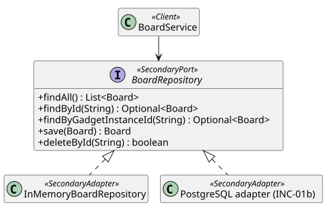

# Adapter

Armature's domain never names a storage engine, a messaging platform, or a protocol SDK; it owns
small ports, and each technology is an adapter behind one. That is how one board model serves an
in memory demo today, PostgreSQL tomorrow, and capability services later, without the domain
changing (plan, "Core abstractions and SOLID").

## Intent

Convert the interface of a technology into the interface the domain expects, so the domain works
with any implementation of its own port.

## The problem in Armature

`BoardService` needs to load and save whole boards. Writing that against a particular database
API would tie every board rule to it and make the zero setup demo impossible. Instead the domain
declares `BoardRepository`, and each storage technology adapts to it.

## Participants

| Role | Class | Responsibility |
| --- | --- | --- |
| Target (port) | [`BoardRepository`](../../backend/src/main/java/com/addf/backend/armature/board/BoardRepository.java) | Whole boards in, whole boards out |
| Adapter | [`InMemoryBoardRepository`](../../backend/src/main/java/com/addf/backend/armature/board/internal/InMemoryBoardRepository.java) | Boards in a map; the demo default |
| Adapter (INC-01b) | PostgreSQL adapter over Spring Data JDBC | Boards as rows plus JSONB |
| Client | [`BoardService`](../../backend/src/main/java/com/addf/backend/armature/board/BoardService.java) | Depends only on the port |

Later adapters follow the same shape: channels (Email, Teams, Slack) behind `OutboundChannel` in
INC-09, and MCP or A2A capability sources behind `CapabilitySource` from INC-06.

## Class diagram

Source: [`adapter.puml`](adapter.puml).

## SOLID callout

**Liskov substitution.** Every adapter passes one contract suite,
[`BoardRepositoryContract`](../../backend/src/test/java/com/addf/backend/armature/board/BoardRepositoryContract.java),
so `BoardService` cannot tell them apart. **Dependency inversion:** the port lives in the domain
module, the adapter in its `internal` package depends on the port, and jMolecules
(`@SecondaryPort`, `@SecondaryAdapter`) plus `ModularityTest` check the direction.

## Tests that prove it

[`InMemoryBoardRepositoryTest`](../../backend/src/test/java/com/addf/backend/armature/board/InMemoryBoardRepositoryTest.java)
runs the contract against the in memory adapter; INC-01b adds the PostgreSQL run of the same suite.

## Exercise

Write a `FileBoardRepository` that keeps each board as a JSON file. Extend
`BoardRepositoryContract` in its test before writing the adapter, and notice that `BoardService`
and the controllers do not change.
