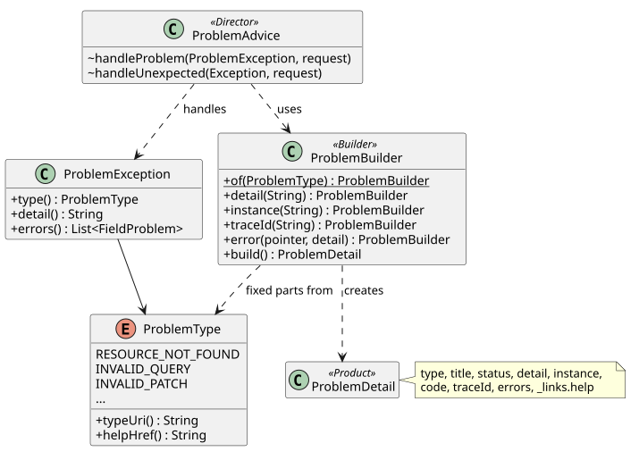

# Builder

Every error Armature returns is a problem whose `type` names a help page, so the same answer
reaches the error UI, the user guide, and the assistant (ADR-0019). That only holds if every
problem is built the same way; the Builder pattern is how the code makes the right shape the only
shape.

## Intent

Separate the construction of a complex object from its parts, so a caller states what is
particular to this occurrence and the builder supplies everything that is always the same.

## The problem in Armature

A problem has parts that must always be right (`type`, `title`, `status`, `code`, the help link)
and parts that vary per occurrence (`detail`, `instance`, `traceId`, `errors`). Building a
`ProblemDetail` by hand in each controller would let one forget the help link, invent its own
title, or leak an exception message. `ProblemBuilder` fills the fixed parts from the
`ProblemType`, so a caller can only add to a correct problem.

## Participants

| Role | Class | Responsibility |
| --- | --- | --- |
| Builder | [`ProblemBuilder`](../../backend/src/main/java/com/addf/backend/armature/problem/ProblemBuilder.java) | Starts from a `ProblemType`; optional steps add the occurrence's parts; `build()` returns the problem |
| Product | Spring's `ProblemDetail` | The RFC 9457 body |
| Catalog | [`ProblemType`](../../backend/src/main/java/com/addf/backend/armature/problem/ProblemType.java) | The fixed parts of each problem, matched one to one by a help page |
| Director | [`ProblemAdvice`](../../backend/src/main/java/com/addf/backend/armature/problem/ProblemAdvice.java) | Turns an exception into builder calls |

## Class diagram

Source: [`builder.puml`](builder.puml).

## SOLID callout

**Single responsibility.** One class makes problem bodies. An ArchUnit rule
([`ProblemArchitectureTest`](../../backend/src/test/java/com/addf/backend/armature/problem/ProblemArchitectureTest.java))
fails the build if any other class creates a `ProblemDetail`, so the responsibility cannot leak.

## Tests that prove it

[`ProblemCatalogTest`](../../backend/src/test/java/com/addf/backend/armature/problem/ProblemCatalogTest.java)
checks that every `ProblemType` has a matching help page and is produced by a test;
[`ProblemAdviceTest`](../../backend/src/test/java/com/addf/backend/armature/problem/ProblemAdviceTest.java)
and the API tests check the built shape with `ProblemAssertions`.

## Exercise

Add a `capability` member (the plan's extension for problems a capability caused): a
`capability(String id)` step on the builder, set only when given. Write the assertion in
`ProblemAdviceTest` first, and notice that no `ProblemType` changes.
