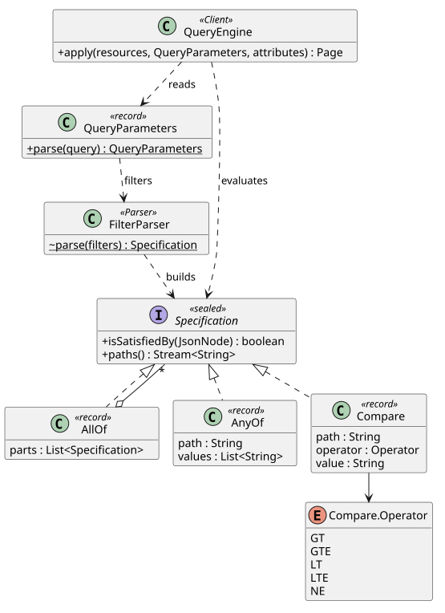

# Interpreter and Specification

Every TMF 630 resource answers the same query language (`state=DRAFT`, `lastUpdate.gt=2026-10-01`,
`board.id=7`), whether a person, an MCP client, or a peer agent is asking. Parsing that language
once into small rule objects is what lets each new resource be queryable with no filtering code of
its own, which keeps "deliver anywhere" cheap (ADR-0007).

## Intent

Represent each sentence of a small language as a tree of objects that can evaluate themselves
(Interpreter), where each object is a business rule a candidate either satisfies or not
(Specification).

## The problem in Armature

The usual alternative is a hand written `if` per query parameter in every controller, or a
`switch` on the operator name repeated for each resource. Both grow with every resource and every
operator, and neither can be tested apart from HTTP. Here the query string is parsed once, into
specifications that read any resource's JSON representation.

## Participants

| Role | Class | Responsibility |
| --- | --- | --- |
| AbstractExpression | [`Specification`](../../backend/src/main/java/com/addf/backend/armature/tmf/Specification.java) | `isSatisfiedBy(resource)`; sealed, so the compiler knows every kind of rule |
| TerminalExpression | [`AnyOf`](../../backend/src/main/java/com/addf/backend/armature/tmf/AnyOf.java) | `attr=value` and `attr=a,b` |
| TerminalExpression | [`Compare`](../../backend/src/main/java/com/addf/backend/armature/tmf/Compare.java) | `attr.gt=`, `.gte=`, `.lt=`, `.lte=`, `.ne=`; each operator is an enum constant holding its own test |
| NonterminalExpression | [`AllOf`](../../backend/src/main/java/com/addf/backend/armature/tmf/AllOf.java) | Several filters joined by `&` |
| Parser | [`FilterParser`](../../backend/src/main/java/com/addf/backend/armature/tmf/FilterParser.java) | Query parameters to an expression tree |
| Client | [`QueryEngine`](../../backend/src/main/java/com/addf/backend/armature/tmf/QueryEngine.java) | Filters, sorts, pages, and selects fields on any resource |

## Class diagram

Source: [`interpreter-specification.puml`](interpreter-specification.puml).

## SOLID callout

**Single responsibility.** Parsing (`FilterParser`), deciding (`Specification`), and fetching
(the repository) are three classes that change for three different reasons. **Open/Closed** shows
in `Compare.Operator`: a new operator is one enum constant, and nothing that evaluates rules
changes.

## Tests that prove it

[`QueryEngineTest`](../../backend/src/test/java/com/addf/backend/armature/tmf/QueryEngineTest.java)
covers every operator, nested and array paths, sorting, paging, and field selection on plain
records, without HTTP.
[`BoardApiTest`](../../backend/src/test/java/com/addf/backend/armature/board/BoardApiTest.java)
runs the same rules through the board API.

## Exercise

Add a `like` operator (`title.like=net*`) that matches a simple wildcard. Add a `LIKE` constant to
`Compare.Operator`, or a new `Like` record if it needs its own evaluation, and a case to
`QueryEngineTest` first. Notice that no controller changes.
